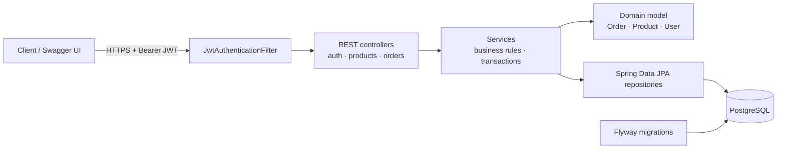

# Orders API

[](https://github.com/vaidikT/orders-api/actions/workflows/ci.yml)


A production-style REST API for a product catalogue and order management, built with **Java 21 and Spring Boot 3**.
It shows how I structure real client backends: secure by default, validated input, consistent errors,
versioned database migrations, tests that run in CI, and a one-command local setup.

## Run it in one command

```bash
docker compose up --build
```

Then open **http://localhost:8080/swagger-ui.html** to explore and call every endpoint.

A demo admin is created on startup (`admin@example.com` / `change-me-please`) and four sample products are seeded.

## Features

| Area | What's included |
| --- | --- |
| Authentication | JWT access tokens, BCrypt password hashing, stateless sessions |
| Authorization | Role-based access (`CUSTOMER`, `ADMIN`) with `@PreAuthorize`; customers only see their own orders |
| Products | Public paginated search, admin-only create / update / delete |
| Orders | Place multi-item orders, stock reservation, cancel with automatic restock, admin status workflow |
| Data integrity | Price snapshot per order line, optimistic locking against overselling the last item, enforced status transitions |
| Errors | RFC 7807 `problem+json` responses with per-field validation messages |
| Database | PostgreSQL with Flyway migrations (`ddl-auto: validate`, never auto-generated) |
| Docs | OpenAPI 3 / Swagger UI with a bearer-token "Authorize" button |
| Ops | Multi-stage Docker image running as non-root, health endpoint, config via environment variables |
| Quality | Unit tests (JUnit 5, Mockito, AssertJ) and end-to-end API tests through the real security chain, run by GitHub Actions on every push |

## Architecture



The code is organised **by feature** (`auth`, `product`, `order`, `user`) rather than by layer, so each area is easy to find and change.
Business rules live in the domain objects. For example, `Order.addItem()` reserves stock and `Order.changeStatus()` enforces the allowed lifecycle:

```
PENDING → PAID → SHIPPED → DELIVERED
   ↘        ↘
    CANCELLED (stock is returned)
```

## API overview

| Method | Endpoint | Access | Description |
| --- | --- | --- | --- |
| POST | `/api/v1/auth/register` | Public | Create a customer account, returns a JWT |
| POST | `/api/v1/auth/login` | Public | Log in, returns a JWT |
| GET | `/api/v1/products?q=&page=&size=` | Public | Search products |
| GET | `/api/v1/products/{id}` | Public | Get one product |
| POST / PUT / DELETE | `/api/v1/products/{id}` | Admin | Manage the catalogue |
| POST | `/api/v1/orders` | Customer | Place an order |
| GET | `/api/v1/orders` | Customer | My orders, newest first |
| GET | `/api/v1/orders/{id}` | Owner or admin | Order details |
| POST | `/api/v1/orders/{id}/cancel` | Owner or admin | Cancel and restock |
| PATCH | `/api/v1/orders/{id}/status` | Admin | Move through the lifecycle |

### Try it with curl

```bash
# 1. Register and keep the token
TOKEN=$(curl -s -X POST localhost:8080/api/v1/auth/register \
  -H 'Content-Type: application/json' \
  -d '{"email":"jane@example.com","password":"password123","fullName":"Jane Doe"}' | jq -r .accessToken)

# 2. Place an order
curl -s -X POST localhost:8080/api/v1/orders \
  -H "Authorization: Bearer $TOKEN" -H 'Content-Type: application/json' \
  -d '{"items":[{"productId":1,"quantity":2}]}' | jq
```

Example error response:

```json
{
  "type": "about:blank",
  "title": "Conflict",
  "status": 409,
  "detail": "Not enough stock for product KB-001 (requested 1000, available 48)",
  "instance": "/api/v1/orders"
}
```

## Configuration

| Variable | Default | Purpose |
| --- | --- | --- |
| `DB_URL` | `jdbc:postgresql://localhost:5432/orders` | JDBC URL |
| `DB_USERNAME` / `DB_PASSWORD` | `orders` / `orders` | Database credentials |
| `JWT_SECRET` | dev-only key | Base64 HMAC key. Generate with `openssl rand -base64 32` |
| `JWT_EXPIRATION_MINUTES` | `60` | Token lifetime |
| `ADMIN_EMAIL` / `ADMIN_PASSWORD` | empty | Creates the first admin on startup if both are set |

## Run without Docker

Requirements: Java 21, Maven 3.9, a running PostgreSQL.

```bash
mvn spring-boot:run      # start the API
mvn verify               # run all tests (uses in-memory H2, no database needed)
```

## Tech stack

Java 21 · Spring Boot 3.3 (Web, Security, Data JPA, Validation, Actuator) · PostgreSQL 16 · Flyway · JJWT · springdoc-openapi · JUnit 5 · Mockito · Docker · GitHub Actions

---

Built by **Vaidik Tandel**, Senior Java Backend Engineer.
I build and maintain Spring Boot backends for startups and agencies. Available for freelance work:
[Upwork](https://www.upwork.com/freelancers/~015afc73e19dae68f9) · [LinkedIn](https://www.linkedin.com/in/vaidik-tandel-091a60187)
